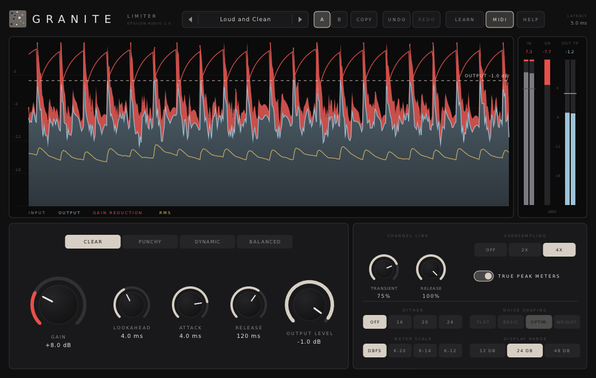

# Granite

**A stereo look-ahead brickwall limiter for macOS, Windows and Linux (VST3 · AU · CLAP · VST2).**

Part of **[Epsilon Audio](https://github.com/natehouk/epsilon-plugins)**, a family of free, open-source plugins: Monolith, Caldera, Obsidian, Strata, Basalt, Gneiss, Mica, Flint, Granite, Magma, Schist, Slate, Talc, Geode and Malachite.



Granite is a clean-room design with the feature set of FabFilter Pro-L, FabFilter's ninth plugin (October 2010). It was written from scratch, working only from FabFilter's public press release and press coverage. No FabFilter code, binaries, presets, artwork or trademarks were used.

It is part of a family of plugins:
- [Monolith](https://github.com/natehouk/monolith) (synth)
- [Caldera](https://github.com/natehouk/caldera) (filter)
- [Obsidian](https://github.com/natehouk/obsidian) (polysynth)
- [Strata](https://github.com/natehouk/strata) (tape delay)
- [Basalt](https://github.com/natehouk/basalt) (live dual filter)
- [Gneiss](https://github.com/natehouk/gneiss) (compressor)
- [Mica](https://github.com/natehouk/mica) (equalizer)
- [Flint](https://github.com/natehouk/flint) (small filter)
- **Granite**, named after the hard, dense stone that won't give

## Download

Get the latest build from [**Releases**](../../releases):

| Platform | File | Contains |
|---|---|---|
| macOS 10.13+ (Apple Silicon + Intel) | `Granite-macos-universal.zip` | VST3, AU, CLAP, manual |
| Windows x64 | `Granite-windows-x64.zip` | VST3, CLAP, VST2, manual |
| Linux x64 | `Granite-linux-x64.zip` | VST3, CLAP, VST2, manual |

### Install

| Platform | Copy | To |
|---|---|---|
| macOS | `Granite.vst3` / `Granite.component` / `Granite.clap` | `~/Library/Audio/Plug-Ins/VST3` / `Components` / `CLAP` |
| Windows | `Granite.vst3` (folder) / `Granite.clap` | `C:\Program Files\Common Files\VST3\` / `CLAP\` |
| Linux | `Granite.vst3` / `Granite.clap` | `~/.vst3/` / `~/.clap/` |

**macOS:** the plugins are ad-hoc signed, not notarized. After copying, run:

```
xattr -dr com.apple.quarantine ~/Library/Audio/Plug-Ins/*/Granite*
```

## Features

**Limiting**
- **Exact brickwall.** No output sample ever exceeds the output level. Tests cover every style, oversampling, look-ahead and attack setting, and random parameter changes at 44.1–192 kHz.
- **Four styles:**
  - **Clear** (transparent, program-dependent release)
  - **Punchy** (short attack, fast release)
  - **Dynamic** (fast recovery after deep peaks)
  - **Balanced** (soft saturation before limiting)
- **Look-ahead** 0–10 ms, **attack** 0.1–10 ms and **release** 1 ms–2 s. At 0 ms look-ahead Granite acts as a clipper.
- **Separate channel linking** for the transient and release stages.
- **Up to 4× linear-phase oversampling.** At 4×, true peaks stay within a few hundredths of a dB of the output level.
- **Gain** 0 to +30 dB and **output level** −30 to 0 dB.

**Output and metering**
- **Dither** to 16, 20 or 24 bit, with **flat, basic, optimized or weighted** noise shaping. The output stays on the bit-depth grid and under the output level.
- **Scrolling level display** of input, output, gain reduction and RMS. Drag up/down to change gain, or drag the output-level line.
- **Meters** for input, gain reduction and output, with **true-peak** detection and peak readouts. **K-System** scales (K-20, K-14, K-12) and 12/24/48 dB ranges.
- **Latency** is shown in the header and reported to the host.

**Workflow**
- **A/B** with copy.
- **Undo/redo** for every edit.
- **MIDI Learn.**
- Smoothed parameters, sample-accurate automation and a resizable interface.
- **27 factory presets:** Mastering, Genres, Mix & Bus and Utility, plus your own presets.
- **Hover tips** everywhere, a **HELP window** and a **[full manual](docs/MANUAL.md)**, also in every release zip as `Granite-Manual.html`.

### Compared with FabFilter Pro-L (2010)

| Pro-L | Granite |
|---|---|
| Four limiting algorithms with their own character | ✓ Clear, Punchy, Dynamic, Balanced |
| Adjustable look-ahead, attack and release | ✓ |
| Separate channel linking for transient and release stages | ✓ |
| Up to 4× linear-phase oversampling against aliasing and inter-sample peaks | ✓ |
| Dithering with three noise-shaping algorithms | ✓ Basic, Optimized, Weighted (plus flat) |
| Output and gain-reduction metering with optional inter-sample peak detection | ✓ |
| Meter scales including K-System | ✓ K-20, K-14, K-12, plus 12/24/48 dB ranges |
| Real-time display of input, output, gain change and RMS over time | ✓ |
| Factory presets by genre | ✓ 27 presets |
| MIDI Learn, undo/redo, A/B, parameter interpolation, sample-accurate automation, help with hints | ✓ |
| Stereo and mono versions | Stereo (use on a mono track with link at 100%) |
| Pro Tools (RTAS/AAX) | Not supported (needs Avid's SDK and signing) |

## Build from source

The plugin is built on [DPF](https://github.com/DISTRHO/DPF):

```
git clone --recursive https://github.com/DISTRHO/DPF.git dpf
make -C plugins/Granite                    # Linux / macOS (macOS also builds the AU)
make -C plugins/Granite WINDOWS=true CC=x86_64-w64-mingw32-gcc CXX=x86_64-w64-mingw32-g++
```

GitHub Actions builds all three platforms on every push. The macOS build is universal and ad-hoc signed. A `v*` tag, or a release published on GitHub, attaches the zips to that release.

## Tests

```
cd tests
g++ -O2 -std=c++11 features.cpp -o features && ./features   # ceiling in 324 setting combinations, exact latency, transparency,
                                                            # gain reduction, linking, release, true-peak limiting/metering, dither
g++ -O2 -std=c++11 fuzz.cpp -o fuzz && ./fuzz               # random parameters at 44.1-192 kHz with loud noise: finite and never over
g++ -O2 -std=c++11 presets.cpp -o presets && ./presets      # plays a test mix through every preset
g++ -O3 -std=c++11 bench.cpp -o bench && ./bench            # CPU at 1x, 2x and 4x
```

Granite takes about 1.4% of one CPU core at 1×, 2.1% at 2× and 3.2% at 4×. These figures include true-peak metering and weighted dither.

Release checks:
- Steinberg's VST3 validator passes 47/47.
- The interface is exercised with scripted input and a live drum-and-bass test mix: gain, styles, oversampling, the display, A/B, K-scales, tips and help.

## Source layout

| File | Contents |
|---|---|
| `plugins/Granite/GraniteEngine.hpp` | All DSP: look-ahead gain computer, release stage, linking, halfband oversampling, dither, true-peak meters, level history. Header-only |
| `plugins/Granite/ParamDefs.hpp` | Parameter table, labels, value mapping |
| `plugins/Granite/Presets.hpp` | Factory presets |
| `plugins/Granite/UserPresets.hpp` | User preset files |
| `plugins/Granite/Help.hpp` | Hover tip text and in-plugin help pages |
| `plugins/Granite/GranitePlugin.hpp/.cpp` | Plugin wrapper: parameters, latency reporting, programs, MIDI Learn |
| `plugins/Granite/GraniteUI.cpp` | Custom vector interface (NanoVG) |
| `docs/MANUAL.md` | User manual (`Granite-Manual.html` is generated from it with pandoc) |

New parameters are only ever appended, so saved sessions and automation keep working across versions.

## License

[MIT](LICENSE). Built with [DPF](https://github.com/DISTRHO/DPF) and its bundled NanoVG, which are under the ISC license. `plugins/Granite/ResizeHandle.hpp` comes from DPF's examples and keeps its ISC notice.

The Optimized and Weighted noise shapers are 3- and 9-tap error-feedback filters after the E- and F-weighted designs in R. Wannamaker, "Psychoacoustically Optimal Noise Shaping", JAES 40(7/8), 1992.

"FabFilter" and "FabFilter Pro-L" are trademarks of FabFilter Software Instruments. Granite is not affiliated with or endorsed by FabFilter.
