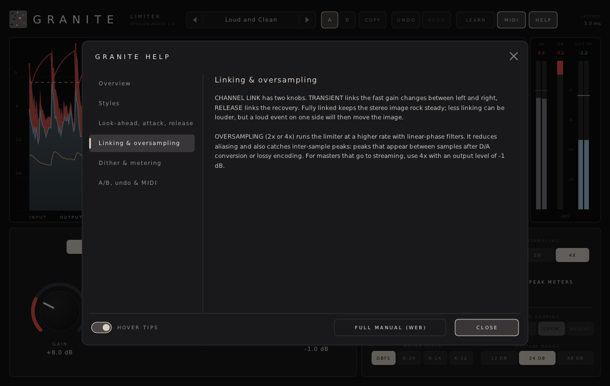

# Granite

**A stereo look-ahead brickwall limiter for macOS, Windows and Linux (VST3 · AU · CLAP · VST2).**

Part of **[Epsilon Audio](https://github.com/natehouk/epsilon-plugins)**, a family of free, open-source plugins: Monolith, Caldera, Obsidian, Strata, Basalt, Gneiss, Mica, Flint, Granite, Magma, Schist, Slate, Talc, Geode and Malachite.


Granite is a clean-room design with the feature set of FabFilter Pro-L 2. Granite 1.x matched the original Pro-L (October 2010). Version 2.0 adds:
- eight styles
- true-peak limiting
- oversampling up to 32×
- an external sidechain
- Unity Gain and Audition Limiting
- a DC filter
- EBU R128 / BS.1770 loudness metering with targets
- display speeds and gain-reduction labels
- a compact layout

It was written from scratch, working only from FabFilter's public product pages, press releases and press coverage. No FabFilter code, binaries, presets, artwork or trademarks were used.

It is part of a family of plugins:
- [Monolith](https://github.com/natehouk/monolith) (synth)
- [Caldera](https://github.com/natehouk/caldera) (filter)
- [Obsidian](https://github.com/natehouk/obsidian) (polysynth)
- [Strata](https://github.com/natehouk/strata) (tape delay)
- [Basalt](https://github.com/natehouk/basalt) (live dual filter)
- [Gneiss](https://github.com/natehouk/gneiss) (compressor)
- [Mica](https://github.com/natehouk/mica) (equalizer)
- [Flint](https://github.com/natehouk/flint) (small filter)
- **Granite**, named after the hard, dense stone that won't give

## Download

Get the latest build from [**Releases**](../../releases):

| Platform | File | Contains |
|---|---|---|
| macOS 10.13+ (Apple Silicon + Intel) | `Granite-macos-universal.zip` | VST3, AU, CLAP, manual |
| Windows x64 | `Granite-windows-x64.zip` | VST3, CLAP, VST2, manual |
| Linux x64 | `Granite-linux-x64.zip` | VST3, CLAP, VST2, manual |

### Install

| Platform | Copy | To |
|---|---|---|
| macOS | `Granite.vst3` / `Granite.component` / `Granite.clap` | `~/Library/Audio/Plug-Ins/VST3` / `Components` / `CLAP` |
| Windows | `Granite.vst3` (folder) / `Granite.clap` | `C:\Program Files\Common Files\VST3\` / `CLAP\` |
| Linux | `Granite.vst3` / `Granite.clap` | `~/.vst3/` / `~/.clap/` |

**macOS:** if a build is not notarized and macOS blocks it, run:

```
xattr -dr com.apple.quarantine ~/Library/Audio/Plug-Ins/*/Granite*
```

## Features

**Limiting**
- **Exact brickwall.** No output sample ever exceeds the output level. Tests cover:
  - every style, oversampling, look-ahead and attack setting
  - random parameter changes at 44.1–192 kHz
- **True-peak limiting.** Inter-sample peaks stay within 0.05 dB of the output level, measured by an independent 8× interpolator.
- **Eight styles:**
  - **Clear**: transparent, program-dependent release
  - **Punchy**: short attack, fast release
  - **Dynamic**: fast recovery after deep peaks
  - **Balanced**: soft saturation before limiting
  - **Aggressive**: the loudest, with harder saturation
  - **Modern**: adaptive, fast after short peaks
  - **Bus**: gentle glue with a long, adaptive release
  - **Safe**: avoids distortion, full look-ahead
- **Timing:** look-ahead 0–10 ms, attack 0.1–10 ms and release 1 ms–2 s. At 0 ms look-ahead Granite acts as a clipper.
- **Separate channel linking** for the transient and release stages.
- **Oversampling** from 2× to 32×, with linear-phase filters.
- **External sidechain**, for stem mastering.
- **DC offset filter.**
- **Gain** 0 to +30 dB and **output level** −30 to 0 dB.

**Listening, output and metering**
- **Unity Gain:** hear the limiting at the original level.
- **Audition Limiting:** hear only what is removed.
- **Loudness metering** to ITU-R BS.1770 / EBU R128:
  - momentary, short-term and integrated loudness, loudness range and true peak
  - targets for EBU R128, ATSC A/85, streaming and podcasts
- **Dither** to 16, 20 or 24 bit, with **flat, basic, optimized or weighted** noise shaping. The output stays on the bit-depth grid and under the output level.
- **Scrolling level display:**
  - input, output, gain reduction and RMS or loudness
  - **gain-reduction peak labels**
  - **display speeds** of 5, 10 or 30 s, or off
  - drag up/down to change gain, or drag the output-level line
- **Meters** for input, gain reduction and output:
  - true-peak detection and peak readouts
  - **K-System** scales (K-20, K-14, K-12)
  - 12/24/48 dB ranges
- **Latency** is shown in the header and reported to the host.

**Workflow**
- **A/B** with copy.
- **Undo/redo** for every edit.
- **MIDI Learn.**
- Smoothed parameters, sample-accurate automation and a resizable interface with a **compact layout**.
- **40 factory presets:** Mastering, Genres, Mix & Bus and Utility, plus your own presets.
- The preset browser **searches** names and categories as you type, and a star keeps a preset in **Favourites**.
- **Hover tips** everywhere, including each style.
- **HELP window** and a **[full manual](docs/MANUAL.md)**, also in every release zip as `Granite-Manual.html`.



### Compared with FabFilter Pro-L 2

| Pro-L 2 | Granite |
|---|---|
| Eight limiting algorithms | ✓ Clear, Punchy, Dynamic, Balanced, Aggressive, Modern, Bus, Safe |
| True-peak limiting | ✓ |
| Up to 32× linear-phase oversampling | ✓ |
| Adjustable look-ahead, attack and release | ✓ |
| Separate channel linking for transient and release stages | ✓ |
| External sidechain triggering | ✓ |
| Unity Gain and Audition Limiting | ✓ |
| DC offset filter | ✓ |
| Loudness metering to EBU R128, ITU-R BS.1770-4 and ATSC A/85 | ✓ M, S, I, LRA, TP, with targets |
| True-peak and gain-reduction metering, K-System scales | ✓ |
| Real-time level display with gain-reduction labels and display modes | ✓ Normal, fast, slow, off |
| Dithering with three noise-shaping algorithms | ✓ Basic, Optimized, Weighted (plus flat) |
| Compact interface | ✓ |
| MIDI Learn, undo/redo, A/B, parameter interpolation, help hints, double-click entry | ✓ |
| Mono, surround and Dolby Atmos (up to 9.1.6) | Stereo only (use on a mono track with link at 100%) |
| AAX, AudioSuite, Pro Tools control surfaces | Not supported (needs Avid's SDK and signing) |
| iPad version | Not supported |

## Build from source

The plugin is built on [DPF](https://github.com/DISTRHO/DPF):

```
git clone --recursive https://github.com/DISTRHO/DPF.git dpf
make -C plugins/Granite                    # Linux / macOS (macOS also builds the AU)
make -C plugins/Granite WINDOWS=true CC=x86_64-w64-mingw32-gcc CXX=x86_64-w64-mingw32-g++
```

GitHub Actions builds all three platforms on every push. The macOS build is universal and ad-hoc signed. A `v*` tag, or a release published on GitHub, attaches the zips to that release.

## Tests

```
cd tests
g++ -O2 -std=c++17 -I../plugins/Granite features.cpp -o features && ./features    # 1.x behaviour: ceiling, latency, transparency, GR, linking, release, true peaks, dither
g++ -O2 -std=c++17 -I../plugins/Granite features2.cpp -o features2 && ./features2 # 2.0: eight styles, 32x, true-peak limiting, sidechain, unity gain, audition,
                                                                                 # DC filter, loudness, latency of every configuration
g++ -O2 -std=c++17 -I../plugins/Granite compat.cpp -o compat && ./compat          # random 1.x settings through the frozen 1.0.1 engine and 2.0: bit-identical
g++ -O2 -std=c++17 -I../plugins/Granite fuzz.cpp -o fuzz && ./fuzz                # random parameters and sidechain at 44.1-192 kHz: finite and never over
g++ -O2 -std=c++17 -I../plugins/Granite presets.cpp -o presets && ./presets       # plays a test mix through every preset
g++ -O3 -std=c++17 -I../plugins/Granite bench.cpp -o bench && ./bench             # CPU, 1x to 32x, with and without true-peak limiting
```

CI runs all of these except the benchmark on every push.

CPU use, as a share of one core at 48 kHz, including true-peak and loudness metering and weighted dither:

| Oversampling | Off | 4× | 8× | 32× |
|---|---|---|---|---|
| CPU | about 2.7% | 5.8% | 7.6% | 25% |
| With true-peak limiting | 3.1% | 8% | 9.5% | 27% |

Release checks:
- Steinberg's VST3 validator passes, including the sidechain bus.
- The interface is exercised with scripted input and live audio, covering:
  - gain, styles, oversampling and true-peak limiting
  - loudness targets and the compact layout
  - tips and help

## Source layout

| File | Contents |
|---|---|
| `plugins/Granite/GraniteEngine.hpp` | All DSP. Header-only. It covers:<br>• look-ahead gain computer, release stage and linking<br>• true-peak stage, sidechain, monitoring and DC filter<br>• dither, metering and level history |
| `plugins/Granite/ParamDefs.hpp` | Parameter table, labels, value mapping |
| `plugins/Granite/Presets.hpp` | Factory presets |
| `plugins/Granite/UserPresets.hpp` | User preset files |
| `plugins/Granite/Help.hpp` | Hover tip text and in-plugin help pages |
| `plugins/Granite/GranitePlugin.hpp/.cpp` | Plugin wrapper. It covers:<br>• parameters and sidechain ports<br>• latency reporting and programs<br>• MIDI Learn and loudness outputs |
| `plugins/Granite/GraniteUI.cpp` | Custom vector interface (NanoVG) |
| `plugins/Granite/common/` | Shared code vendored from [epsilon-common](https://github.com/natehouk/epsilon-common) (see its `VERSION` file). Granite uses its oversampling and loudness metering |
| `tests/legacy/` | Frozen 1.0.1 engine, used by the compatibility test |
| `docs/MANUAL.md` | User manual (`Granite-Manual.html` is generated from it with pandoc) |

New parameters, styles and presets are only ever appended, so saved sessions and automation keep working across versions.

## Changelog

- **Unreleased:** the preset browser searches names and categories as you type, and keeps Favourites.
- **2.0:** Brings Granite up to Pro-L 2. New in this version:
  - Four new styles: Aggressive, Modern, Bus and Safe.
  - True-peak limiting.
  - Oversampling up to 32×.
  - External sidechain.
  - Unity Gain and Audition Limiting.
  - DC filter.
  - Loudness metering with targets.
  - Display speeds and gain-reduction labels.
  - Compact layout.
  - Thirteen new presets.

  Sessions, automation and presets from 1.x load and sound the same. A test checks this against the frozen 1.0.1 engine.

  Style and Oversampling now have more entries. In hosts that store automation as a 0–1 position, check those lanes after upgrading.
- **1.0.1:** Right-click actions respond to the right mouse button.
- **1.0:** First release.

## License

[MIT](LICENSE). Built with [DPF](https://github.com/DISTRHO/DPF) and its bundled NanoVG, which are under the ISC license. `plugins/Granite/ResizeHandle.hpp` comes from DPF's examples and keeps its ISC notice.

The Optimized and Weighted noise shapers are 3- and 9-tap error-feedback filters after the E- and F-weighted designs in R. Wannamaker, "Psychoacoustically Optimal Noise Shaping", JAES 40(7/8), 1992.

"FabFilter", "FabFilter Pro-L" and "Pro-L 2" are trademarks of FabFilter Software Instruments. Granite is not affiliated with or endorsed by FabFilter.
