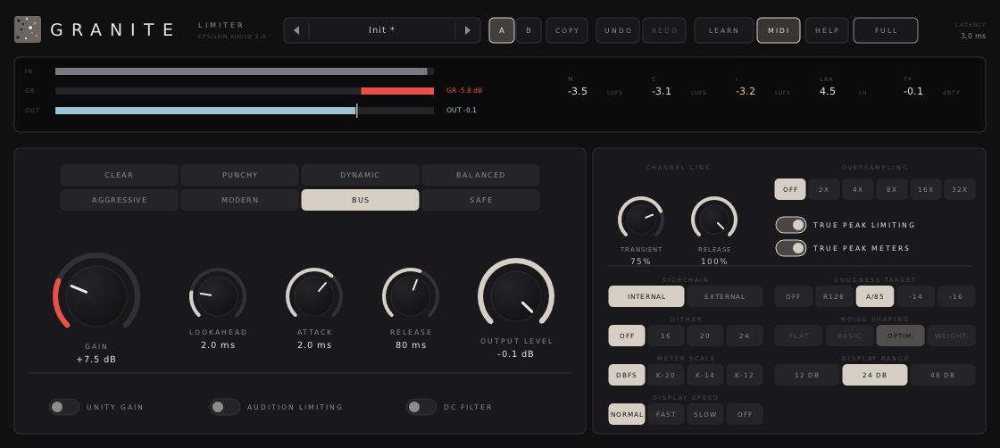

# Granite 2.0 — User Manual

Granite is a stereo brickwall limiter. It makes audio louder while guaranteeing that nothing goes above the output level you set.

It has:
- **Eight limiting styles.**
- **Timing controls:** adjustable look‑ahead, attack and release.
- **Channel linking:** separate linking for the transient and release stages.
- **Peak control:** linear‑phase oversampling up to 32×, and **true‑peak limiting**.
- **An external sidechain.**
- **Monitoring:** Unity Gain and Audition Limiting.
- **A DC filter.**
- **Metering:** loudness metering to ITU‑R BS.1770 / EBU R128 with targets, and a scrolling display with gain‑reduction labels.
- **Dither** with noise shaping.
- **A compact layout.**

Granite runs as VST3, AU, CLAP and VST2 on macOS, Windows and Linux.

**Contents**

1. [Installing](#1-installing)
2. [A quick tour](#2-a-quick-tour)
3. [Getting loud safely](#3-getting-loud-safely)
4. [Styles](#4-styles)
5. [Look‑ahead, attack and release](#5-lookahead-attack-and-release)
6. [Channel linking](#6-channel-linking)
7. [Oversampling and true peaks](#7-oversampling-and-true-peaks)
8. [Loudness metering](#8-loudness-metering)
9. [External sidechain](#9-external-sidechain)
10. [Unity Gain, Audition Limiting and the DC filter](#10-unity-gain-audition-limiting-and-the-dc-filter)
11. [Dither and noise shaping](#11-dither-and-noise-shaping)
12. [The display and meters](#12-the-display-and-meters)
13. [Compact layout](#13-compact-layout)
14. [Knobs](#14-knobs)
15. [A/B, undo and redo](#15-ab-undo-and-redo)
16. [MIDI Learn](#16-midi-learn)
17. [Presets](#17-presets)
18. [Help and hover tips](#18-help-and-hover-tips)
19. [Recipes](#19-recipes)
20. [Keyboard and mouse reference](#20-keyboard-and-mouse-reference)
21. [Latency and CPU](#21-latency-and-cpu)
22. [Parameter reference](#22-parameter-reference)
23. [Compatibility with Granite 1.x](#23-compatibility-with-granite-1x)
24. [Troubleshooting](#24-troubleshooting)

---

## 1. Installing

Download the zip for your system from the project's **Releases** page and copy the plugin files:

| System | Copy | To |
|---|---|---|
| macOS | `Granite.vst3`, `Granite.component` (AU), `Granite.clap` | `~/Library/Audio/Plug-Ins/VST3`, `.../Components`, `.../CLAP` |
| Windows | the `Granite.vst3` folder, `Granite.clap` | `C:\Program Files\Common Files\VST3\`, `...\CLAP\` |
| Linux | `Granite.vst3`, `Granite.clap` | `~/.vst3/`, `~/.clap/` |

**macOS:** if a build is not notarized, macOS may block it the first time. Open Terminal and run:

```
xattr -dr com.apple.quarantine ~/Library/Audio/Plug-Ins/*/Granite*
```

Rescan plugins in your DAW. Granite appears under **Epsilon Audio** as a dynamics/mastering effect. Version 2.0 replaces 1.x in place: your sessions and presets keep working and sound the same (see [section 23](#23-compatibility-with-granite-1x)).

---

## 2. A quick tour


- **Header:**
  - preset browser
  - A/B and COPY
  - UNDO/REDO
  - LEARN (MIDI Learn) and MIDI on/off
  - HELP
  - COMPACT
  - the current latency, at the far right
- **Level display:** the last few seconds, scrolling left. It shows:
  - the input in grey
  - the output in blue‑grey
  - the gain reduction in red, with labels at its deepest moments
  - the output RMS as a yellow line, or the momentary loudness in violet when a loudness target is set
  - the output level as a dashed line you can drag
- **Meters:** input, gain reduction and output, with peak readouts, and the **loudness** readouts beside them.
- **Main panel:**
  - the eight STYLES
  - GAIN, LOOKAHEAD, ATTACK, RELEASE and OUTPUT LEVEL
  - UNITY GAIN, AUDITION LIMITING and DC FILTER
- **Advanced panel:**
  - channel link
  - oversampling
  - true‑peak limiting and true‑peak meters
  - sidechain
  - loudness target
  - dither and noise shaping
  - meter scale, display range and display speed

---

## 3. Getting loud safely

1. Set **OUTPUT LEVEL** to the highest level you want to allow:
   - **−1 dB** for streaming and lossy formats
   - **−0.3 dB** for CD
   - **−0.1 dB** as a safety limiter inside a mix
2. For final masters:
   - Turn on **TRUE PEAK LIMITING**, so peaks between samples stay under the output level too.
   - Set **OVERSAMPLING** to **4×** or **8×** to keep the limiting clean.
3. Turn up **GAIN** while you watch the red area in the display and the GR meter:
   - 1–3 dB of gain reduction is usually inaudible.
   - 4–6 dB is loud and still clean on most material.
   - Beyond that, the music starts to flatten.
4. Check the integrated loudness (**I**). Choose a **LOUDNESS TARGET** to see where you stand.
5. Use **UNITY GAIN** or **A/B** to compare with the loudness matched. Louder always sounds better at first.

The limit is exact: whatever gain, style, look‑ahead, attack or release you choose, no output sample goes above the output level. With true‑peak limiting on, no inter‑sample peak does either.

---

## 4. Styles

| Style | Character | Good for |
|---|---|---|
| **Clear** | The most transparent. When it has to limit for a while, it lengthens its release so the level does not pump. | Mastering, acoustic music, anything delicate |
| **Punchy** | Shorter attack and half the release. Keeps drums snappy and loud. | Electronic, hip‑hop, drum buses |
| **Dynamic** | Recovers faster the deeper it has had to limit, so short peaks leave little trace. | Jazz, acoustic, material with big transients |
| **Balanced** | Rounds the very top of the peaks off with soft saturation before limiting: a touch of warmth and less gain reduction for the same loudness. | Rock, metal, broadcast |
| **Aggressive** | The loudest: very fast attack and release, with harder saturation of the peaks. Adds density and grit. | EDM, trap, loud genres; watch the bass |
| **Modern** | Adapts to the material: recovers quickly from short peaks and slows down during sustained limiting. | Most modern pop and electronic masters |
| **Bus** | Gentle glue: a longer release that lengthens further during sustained limiting. | Buses, stems, glue rather than loudness |
| **Safe** | Avoids distortion above all: always uses the full look‑ahead and never releases faster than 40 ms. It may pump a little more instead. | Broadcast, dialog, critical material |

Hover over a style button for its description.

---

## 5. Look‑ahead, attack and release

- **LOOKAHEAD** (0–10 ms):
  - Granite delays the audio by this amount so it can see peaks coming and lower the gain smoothly before they arrive.
  - Your DAW compensates the delay automatically. The current latency is shown at the top right.
  - At 0 ms Granite behaves like a clipper.
- **ATTACK** (0.1–10 ms) sets how gradually the gain comes down ahead of a peak:
  - Longer is smoother and more transparent.
  - Shorter keeps more of the transient's snap.
  - Attack cannot be longer than the look‑ahead. The knob shows "LIMITED BY LOOKAHEAD" when it is.
  - The Safe style always uses the whole look‑ahead.
- **RELEASE** (1 ms – 2 s) sets how quickly the gain recovers:
  - Short release is louder, but can distort bass and make the level pump.
  - Long release is smoother, but holds the level down after loud hits.
  - Most styles adapt the release to the music, as described in section 4.

Changing the look‑ahead, the oversampling or true‑peak limiting while audio plays makes Granite fade out and back in over a few milliseconds, because its latency changes.

---

## 6. Channel linking

Granite links the left and right channels in two stages, each with its own knob:

- **TRANSIENT** links the fast gain changes.
- **RELEASE** links the recovery.

At 100%, both channels are turned down together, so a loud event on one side does not move the stereo image. Lower values let each side be limited on its own. That can be louder, but one‑sided peaks will then shift the image.

The defaults (75% transient, 100% release) keep the image steady while allowing a little extra loudness.

---

## 7. Oversampling and true peaks

When audio is converted to analog, or encoded to MP3 or AAC, the waveform between the samples can peak higher than any sample. These are **inter‑sample** or **true** peaks, and they can clip a converter or a codec.

- **OVERSAMPLING** runs the limiter at 2×, 4×, 8×, 16× or 32× the sample rate with linear‑phase filters:
  - It reduces aliasing distortion when limiting hard.
  - It catches most inter‑sample peaks.
  - The filters add 32, 48, 56, 60 or 62 samples of latency.
  - 16× and 32× cost noticeably more CPU (see [section 21](#21-latency-and-cpu)). 4× or 8× suits most masters.
- **TRUE PEAK LIMITING** limits the true peak itself:
  - Granite interpolates its output 4× and turns the gain down a little more wherever an interpolated point would cross the output level.
  - It adds about 1 ms of latency.
  - Measured with an independent 8× interpolator, true peaks stay within 0.05 dB of the output level, with or without oversampling.
  - Without oversampling, the stage keeps an extra 0.1 dB of headroom, because the 4× interpolation is least exact close to the Nyquist frequency.
- **TRUE PEAK METERS** makes the output meter show the estimated true peak (labelled "OUT TP"). It does not change the sound.

---

## 8. Loudness metering

The **LOUDNESS** readouts beside the meters measure Granite's output to ITU‑R BS.1770 and EBU R128:

| Readout | Meaning |
|---|---|
| **M** | Momentary loudness, over 400 ms |
| **S** | Short‑term loudness, over 3 s |
| **I** | Integrated loudness since the last reset, gated as the standard describes |
| **LRA** | Loudness range |
| **TP** | The highest true peak since the last reset, in dBTP |

Click the readouts to reset I, LRA and TP, for example before playing a song from the top.

**LOUDNESS TARGET** shows a target in the display, as a ±1 LU band, and plots the momentary loudness there instead of the RMS level. The integrated value turns green when it is within 1 LU of the target.

| Target | Level |
|---|---|
| **R128** | EBU R128 broadcast, −23 LUFS |
| **A/85** | ATSC A/85 (US broadcast), −24 LKFS |
| **−14** | Typical streaming level, −14 LUFS |
| **−16** | Podcasts and spoken word, −16 LUFS |

The target is a display setting. It does not change the sound, and presets leave it alone.

---

## 9. External sidechain

With **SIDECHAIN** set to **EXTERNAL**, Granite decides its gain from the signal on its sidechain input instead of from its own audio. The audio follows that gain.

The classic use is **stem mastering**:
1. Feed the full mix to the sidechain of a Granite on each stem.
2. Give every instance the same settings as the limiter on the mix.
3. Each stem is now limited exactly when, and as much as, the mix is, so the stems add up to the limited master.

Notes:
- In External mode the audio itself is not clamped to the output level: only the sidechain is held to it.
- True‑peak limiting has no effect in External mode, though its latency stays.
- If the sidechain is silent, the audio passes unchanged.
- Routing the sidechain works as for any plugin with a sidechain input (Logic: the Side Chain menu; Ableton Live: Audio From in the sidechain section; Reaper: channels 3/4; Cubase and Studio One: activate the sidechain, then add a send).

---

## 10. Unity Gain, Audition Limiting and the DC filter

- **UNITY GAIN** turns the output down by the GAIN amount. You hear what the limiting does to the sound at the level you started from, without being fooled by extra loudness.
- **AUDITION LIMITING** plays only what the limiter removes: the input minus the output. Use it to hear exactly when limiting starts to bite into the music. With Unity Gain on as well, the removed part plays at the original level.

Both are listening aids. A badge in the display reminds you while either is on, and presets, A/B and undo leave them alone. **Switch them off before you export.**

- **DC FILTER** removes DC offset before limiting, with a gentle 5 Hz high‑pass. DC wastes headroom and makes the limiter work harder on one side of the waveform.

---

## 11. Dither and noise shaping

When a final master is exported at a lower bit depth (for example 16‑bit for CD), the last bits are thrown away. Without dither, quiet passages and fade‑outs turn grainy.
- **DITHER** adds a tiny amount of noise so that never happens.
- **NOISE SHAPING** moves that noise to frequencies where the ear is least sensitive.

| Setting | What it does |
|---|---|
| DITHER **Off / 16 / 20 / 24** | Bit depth to dither to. Off passes the full floating‑point output. |
| **Flat** | Plain triangular (TPDF) dither, white noise. |
| **Basic** | Gentle first‑order shaping: less noise in the midrange, more at the top. |
| **Optimized** | Three‑stage shaping to a hearing curve. |
| **Weighted** | Nine‑stage shaping to a hearing curve. The quietest‑sounding option at 44.1 and 48 kHz. |

Use dither once, as the very last step of a final master, at the bit depth you export. Don't dither inside a mix or before more processing.

The output stays on the chosen bit‑depth grid and never goes above the output level.

---

## 12. The display and meters

- **Display**:
  - Drag up or down anywhere to change **Gain**. The mouse wheel does the same, and Shift is for fine steps.
  - Drag the dashed **output level** line to set the output level.
  - **Labels** on the gain‑reduction trace mark the deepest limiting in each stretch.
- **DISPLAY SPEED** sets how much history the display shows:

  | Setting | History |
  |---|---|
  | NORMAL | 10 s |
  | FAST | 5 s |
  | SLOW | 30 s |
  | OFF | none; only the meters run |

- **DISPLAY RANGE** zooms the display and meters to the top 12, 24 or 48 dB.
- **METER SCALE** switches the scale labels to the K‑System (K‑20, K‑14, K‑12). There, 0 sits at an average level 20, 14 or 12 dB below full scale, which helps you judge loudness consistently.
- **Peak readouts** above the meters hold the highest input, gain reduction and output since you last reset them. Click the meters to reset.

---

## 13. Compact layout

**COMPACT** in the header shrinks the window. The level display and meters are replaced by a single strip, which holds:
- horizontal input, gain‑reduction and output meters
- the loudness readouts

**FULL** brings the display back. The layout is saved with your project.



---

## 14. Knobs

- **Drag** the middle of a knob up or down. Hold **Shift** for fine adjustment.
- **Grab the rim** to turn the knob in a circle.
- **Mouse wheel** turns a knob.
- **Double‑click** to type a value, then Enter (or Esc to cancel). Release accepts `1.5s`.
- **Ctrl‑click** (Cmd‑click on macOS) resets to the default.

---

## 15. A/B, undo and redo

- **A / B** hold two complete settings. Click the other letter to switch; the first time, B starts as a copy of A.
- **COPY** copies the current setting into the other slot.
- **UNDO / REDO** step through every edit, including preset loads and A/B switches.
  - Undo: Cmd/Ctrl‑Z
  - Redo: Cmd/Ctrl‑Shift‑Z or Cmd/Ctrl‑Y

Display and listening switches (Unity Gain, Audition Limiting, loudness target, display speed, compact layout) are not part of a setting, so A/B, undo and presets leave them as they are.

---

## 16. MIDI Learn

1. Click **LEARN**.
2. Click a control.
3. Move a knob or fader on your controller.
4. Click **LEARN** again (or press Esc) to finish.

While learning, right‑click a control to unassign it, or use **CLEAR ALL ASSIGNMENTS**. Assignments are saved with your project. The **MIDI** button turns MIDI control off without forgetting them.

---

## 17. Presets

| Group | Presets |
|---|---|
| Mastering | Transparent Master, Loud and Clean, Streaming −1 dBTP, CD 16‑bit Final, Gentle Glue, Vinyl Premaster; Streaming True Peak, Loud Modern Master, Safe Master, 32x Clear Master |
| Genres | EDM, Hip‑Hop, Rock, Pop, Acoustic, Jazz, Metal, Ambient; Aggressive EDM, Modern Pop, Trap 808 |
| Mix & Bus | Drum Bus, Snare Peaks, Vocal Catch, Bass Leveler, Wide Bus, Pumping; Bus Glue, Stem (Sidechain), Mix Bus Safety |
| Utility | Safety Limiter, Broadcast, Soft Clipper, Dither to 16‑bit, Dither to 24‑bit, K‑14 Metering; DC + True Peak, Podcast Voice, Broadcast True Peak |

The presets after the semicolon are new in 2.0. They come after the 1.x presets, so 1.x program numbers stay the same. The genre presets are starting points; set Gain by ear for your material.

- **SAVE CURRENT AS…** stores your own presets, in one of these folders:
  - macOS: `~/Library/Audio/Presets/Epsilon Audio/Granite`
  - Windows: `%APPDATA%\Epsilon Audio\Granite\Presets`
  - Linux: `~/.config/epsilon-audio/granite/presets`
- To delete one of your presets, right‑click it in the browser and click again to confirm.

**Search and favourites.** With the browser open, just type to narrow the list to presets whose name or category matches; Backspace edits, Esc clears the search and then closes the browser. Click the star at the right of a preset to add it to the FAVOURITES column, and again to remove it. Favourites are kept in `favourites.txt` in your presets folder.

---

## 18. Help and hover tips

- Rest the pointer on any of these and, after a moment, a tip explains it and shows its value:
  - controls and header buttons
  - the display and the output level line
  - the meters and the loudness readouts
  - each style button
- **HELP** opens the in‑plugin pages.
- The switch at the bottom of the help window turns tips on or off.
- **FULL MANUAL (WEB)** opens this manual.

---

## 19. Recipes

- **Streaming master:**
  - Style: Modern or Clear
  - Oversampling: 4×
  - True peak limiting: on
  - Output level: −1 dB
  - Loudness target: −14
  - Look‑ahead 4 ms, attack 3 ms, release 150 ms
  - Gain: until I settles where you want it
- **Loud electronic master:**
  - Style: Aggressive or Punchy
  - Look‑ahead 1.5 ms, attack 1 ms, release 40 ms
  - Oversampling: 8×
  - True peak limiting: on
  - Output level: −0.8 dB
- **Broadcast (EBU R128):**
  - Style: Safe
  - Output level: −2 dB (R128 allows −1 dBTP; leave some room)
  - True peak limiting: on
  - Loudness target: R128
  - Adjust your mix until I reads −23 LUFS
- **Stem mastering:** the Stem (Sidechain) preset on each stem, with the full mix routed to its sidechain (see [section 9](#9-external-sidechain)).
- **Judging the limiting:** turn on UNITY GAIN to compare at the same level, and AUDITION LIMITING to hear what is being removed.
- **CD export:**
  - Output level: −0.3 dB
  - Oversampling: 4×
  - Dither: 16 bit, Weighted
  - Export at 16‑bit with no further processing.

---

## 20. Keyboard and mouse reference

| Action | How |
|---|---|
| Change Gain | Drag up/down in the display, or mouse wheel over it |
| Change output level | Drag the dashed line |
| Reset peak readouts | Click the meters |
| Reset loudness (I, LRA, TP) | Click the loudness readouts |
| Fine adjustment | Shift‑drag, Shift‑wheel |
| Type a value | Double‑click a knob |
| Reset a knob | Ctrl/Cmd‑click |
| Undo / redo | Ctrl/Cmd‑Z / Ctrl/Cmd‑Shift‑Z or Ctrl/Cmd‑Y |
| Step presets | Arrows or mouse wheel on the preset name |
| Compact / full layout | COMPACT / FULL in the header |
| Close help, finish Learn, cancel typing | Esc |

---

## 21. Latency and CPU

Latency is the sum of the parts below. Granite reports it to the host, which compensates automatically.

| Part | Latency |
|---|---|
| Look‑ahead | as set (0–10 ms) |
| Oversampling 2× / 4× / 8× / 16× / 32× | 32 / 48 / 56 / 60 / 62 samples |
| True‑peak limiting | about 1 ms (24 samples plus 0.5 ms) |

CPU use, as a share of one core at 48 kHz, with heavy limiting, true‑peak meters, loudness metering and weighted dither:

| Oversampling | Off | 2× | 4× | 8× | 16× | 32× |
|---|---|---|---|---|---|---|
| Without true‑peak limiting | 2.7% | 3.4% | 5.8% | 7.6% | 15% | 25% |
| With true‑peak limiting | 3.1% | 4.0% | 8.0% | 9.5% | 14% | 27% |

---

## 22. Parameter reference

New parameters are only ever added at the end, so sessions and automation keep working across versions.

| # | Name | Range | Default |
|---|---|---|---|
| 0 | Gain | 0 – +30 dB | 0 dB |
| 1 | Output Level | −30 – 0 dB | −0.1 dB |
| 2 | Style | Clear / Punchy / Dynamic / Balanced / Aggressive / Modern / Bus / Safe | Clear |
| 3 | Lookahead | 0 – 10 ms | 2 ms |
| 4 | Attack | 0.1 – 10 ms | 2 ms |
| 5 | Release | 1 ms – 2 s | 80 ms |
| 6 | Link Transients | 0 – 100% | 75% |
| 7 | Link Release | 0 – 100% | 100% |
| 8 | Oversampling | Off / 2× / 4× / 8× / 16× / 32× | Off |
| 9 | True Peak Meters | Off / On | On |
| 10 | Dither | Off / 16 / 20 / 24 bit | Off |
| 11 | Noise Shaping | Flat / Basic / Optimized / Weighted | Optimized |
| 12 | Meter Scale (display) | dBFS / K‑20 / K‑14 / K‑12 | dBFS |
| 13 | Display Range (display) | 12 / 24 / 48 dB | 24 dB |
| 14 | MIDI | Off / On | On |
| 15–20 | Outputs for the meters and MIDI Learn | read‑only | — |
| 21 | True Peak Limiting | Off / On | Off |
| 22 | Sidechain | Internal / External | Internal |
| 23 | DC Filter | Off / On | Off |
| 24 | Unity Gain (listening) | Off / On | Off |
| 25 | Audition Limiting (listening) | Off / On | Off |
| 26 | Loudness Target (display) | Off / R128 −23 / A/85 −24 / −14 / −16 | Off |
| 27 | Display Speed (display) | Normal / Fast / Slow / Off | Normal |
| 28 | Compact View (display) | Off / On | Off |
| 29–33 | Outputs: momentary, short‑term and integrated loudness, loudness range, true‑peak maximum | read‑only | — |

---

## 23. Compatibility with Granite 1.x

Granite 2.0 is the same plugin (same IDs), version 2.0.

- **Sessions load and sound the same.** Every 1.x parameter keeps its number and meaning. The 2.0 parameters come after them, with defaults that change nothing.
  - An automated test plays random 1.x settings, with changes mid‑stream, through a frozen copy of the 1.0.1 engine and through 2.0.
  - The outputs are bit‑identical and the latency matches.
- **Ranges that grew:** Style now has eight entries instead of four, and Oversampling six instead of three. Stored values keep their meaning. Hosts that store automation as a 0–1 position along a control's range may map existing automation lanes for these two controls differently, so check them after upgrading.
- **Factory presets** keep their program numbers; the thirteen 2.0 presets come after them. **User presets** and **MIDI Learn** assignments carry over.
- **Sidechain input:** Granite now has a stereo sidechain input. It is only used when SIDECHAIN is set to EXTERNAL.
- **Window:** larger by default (1120 × 730), with a compact layout, and it still resizes freely.

---

## 24. Troubleshooting

- **Granite doesn't appear in my DAW.** Check the install folders above and rescan plugins. On macOS, run the `xattr` command from section 1.
- **Audio drops out for a moment when I change look‑ahead, oversampling or true‑peak limiting.** That is intended: the latency changes, so Granite fades out and back in over a few milliseconds. Set these before playback for a final render.
- **The output is quieter than expected, or sounds thin or odd.** UNITY GAIN or AUDITION LIMITING is on (see the badge in the display). Switch them off.
- **The meters show true peaks above the output level.** Turn on TRUE PEAK LIMITING. Without it, Granite limits samples, and with oversampling off a true‑peak meter can read up to a few dB higher.
- **External sidechain does nothing.** Check that the sidechain input actually receives audio in your DAW. With a silent sidechain the audio passes unchanged.
- **High CPU.** 16× and 32× oversampling are the heaviest settings. 4× or 8× with true‑peak limiting is usually enough.
- **It pumps or distorts.** Lower Gain, lengthen Release, or try the Clear or Safe style. On bass‑heavy material, a release below about 30 ms can distort low notes.
- **Hiss on silence.** Dither is on. That is expected at 16 bit; turn dither off unless you are exporting the final master at a lower bit depth.
